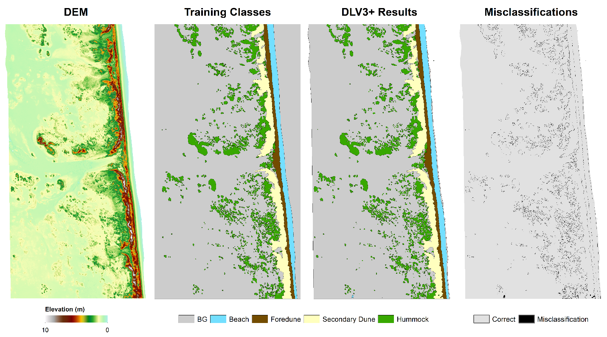

# Deep-learning landform segmentation from LiDAR

**Data:** LiDAR-derived elevation models (DEMs) of Padre Island National Seashore, TX, surveyed in 2000, 2005, 2009, 2012, 2016 and 2018.
**Method:** DeepLabV3+ semantic segmentation (MobileNetV2 backbone) trained on 256 × 256 m elevation tiles with hand-annotated landform masks and data augmentation. Watershed segmentation was used alongside it to find smaller features inside each landform.
**Result:** ~97.8% accuracy on the training site. The model applied to all six survey years without retraining, so dune toe, crest and heel positions could be tracked over 18 years.

📄 Dissertation Chapter 4 — *Characterizing complex barrier island topographic patterns using image segmentation* (in preparation)

## Figures

**Model output vs. hand annotations (2009).** Elevation model, annotated classes, DeepLabV3+ prediction and misclassified cells. Most errors fall on class boundaries.

**One model, six survey years.** Predictions for 2000–2018 alongside each year's elevation model.

Python 3.9, TensorFlow/Keras.
