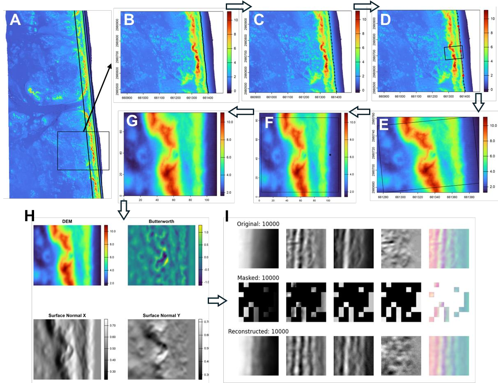
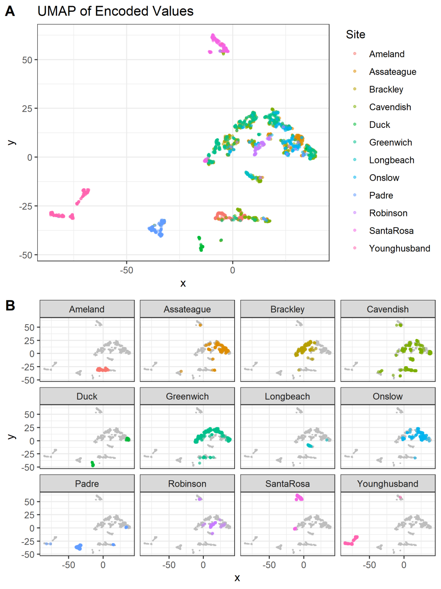
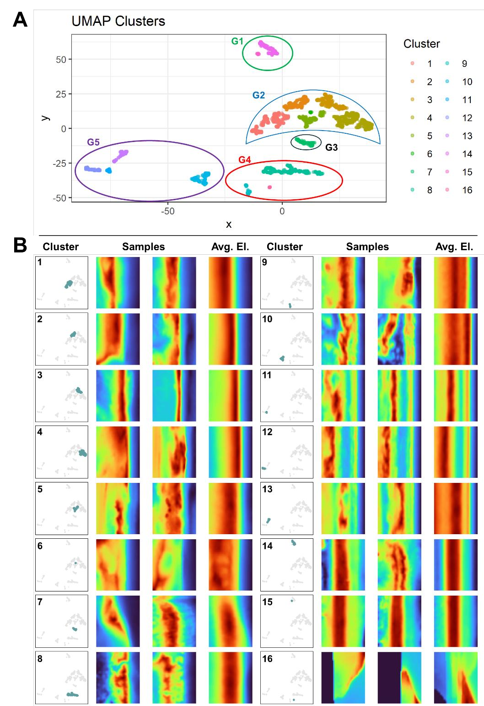

# Unsupervised dune classification with a masked autoencoder

**Data:** 1,800 beach-dune elevation samples from 12 coastal sites across North America, Europe and Australia.
**Method:** Samples were cut automatically from each site's elevation model, aligned to the shoreline and fed to a masked autoencoder (75% masking, TensorFlow 2.10). The learned encodings were reduced with UMAP and clustered with DBSCAN.
**Result:** 16 dune shape types in 5 broader groups. Within-site and between-site similarity shows which coastlines share dune forms, which can support dune management and conservation.

📄 Dissertation Chapter 5 — *Unmasking the topographic complexity of coastal barrier systems* (in preparation)

## Figures

**Workflow.** From elevation model to dune-toe detection, sample extraction and rotation, to autoencoder reconstruction.

**Where each site falls in the learned feature space.**

**16 clusters, with example samples and the average elevation for each.**

Python, TensorFlow, umap-learn, scikit-learn.
