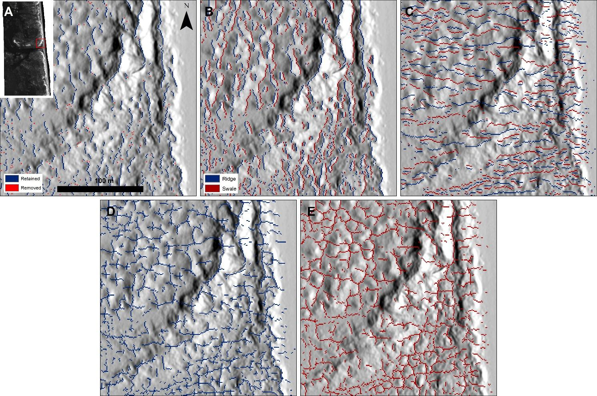
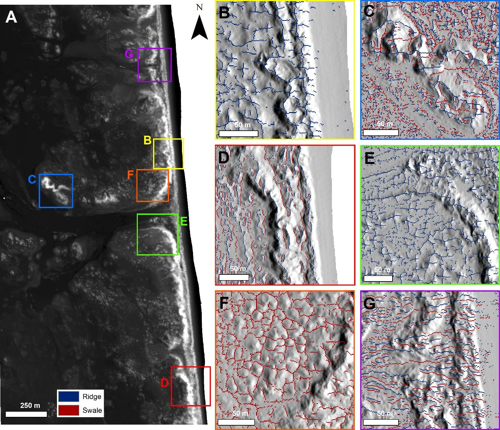

# 3D ridge-and-swale mapping of barrier islands

**Data:** 2009 LiDAR-derived elevation model (USACE JALBTCX) of North Padre Island, TX.
**Method:** Surface-normal vectors calculated in a moving window. Ridges and swales are flagged where the slope direction flips in either the alongshore or cross-shore direction, and the analysis is repeated at window sizes from 3 to 15 m to separate small features from large ones.
**Result:** A map of ridge and swale structure across the whole island rather than along single profiles. It picks up blowout rims, relic washover channels and hummock fields that 2D profile methods treat as one continuous dune.

📄 Lehner, J., Wernette, P., Smith, A. and Houser, C., 2024. Multi-dimensional approach for interpreting the structure of barrier island morphology. *Geomorphology*, 447, 109006. [DOI link](LINK)

## Figures

**Ridge and swale patterns:** alongshore, cross-shore and combined.

**What the method reveals:** blowout rims, backbarrier structure, washover arms and hummock footprints.

R
