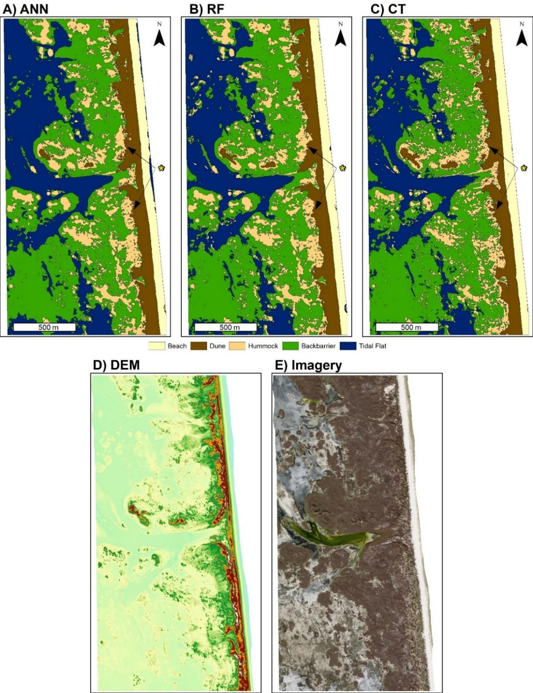
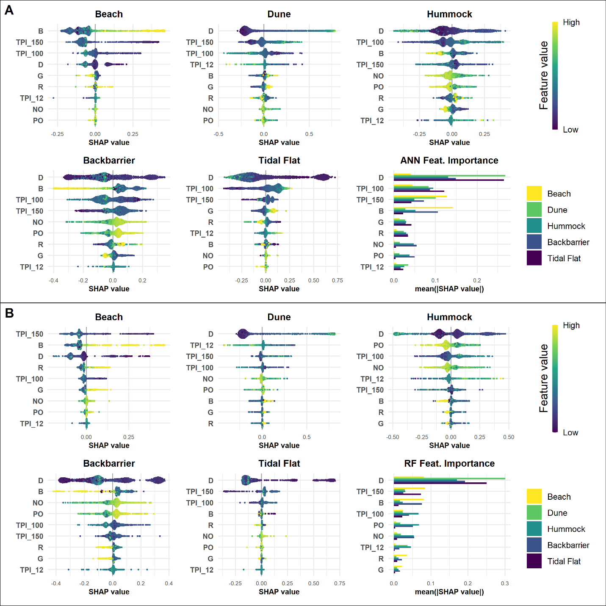

# Comparing and explaining landform classifiers

**Data:** 1 m rasters for Padre Island National Seashore: a 2009 LiDAR elevation model, NAIP aerial imagery (RGB), topographic openness and topographic position index at several scales.
**Method:** A multilayer perceptron neural network, a random forest and a classification tree, each trained to classify beach, dune, hummock, backbarrier and tidal flat. SHAP values explain which inputs drive each model's predictions, and dune toe and crest positions were extracted from each model's output and compared.
**Result:** Random forest ~98.7%, neural network ~97.7%, classification tree ~92.2%. Beach and tidal flat were classified at over 99%. The models were tested on sites 3.7 km and 17 km from the training area.

## Figures

**Predictions from all three models** with the elevation and imagery inputs for reference.

**SHAP feature importance** for the neural network (A) and random forest (B), by landform class.

R: keras, randomForest, rpart, kernelshap.
