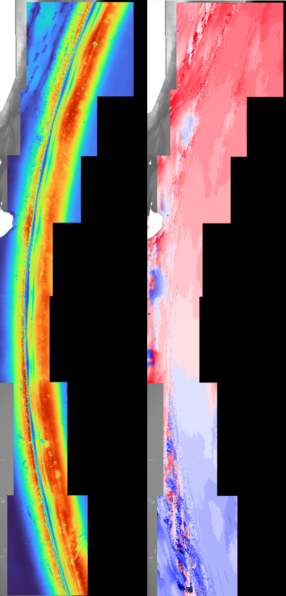
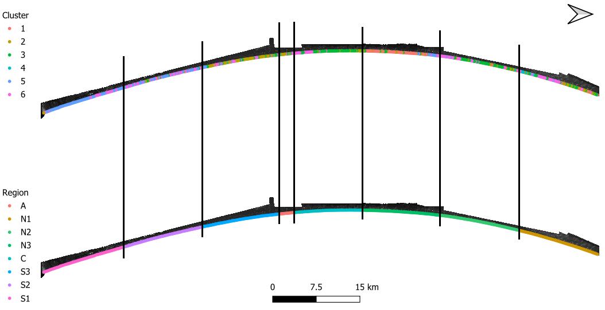
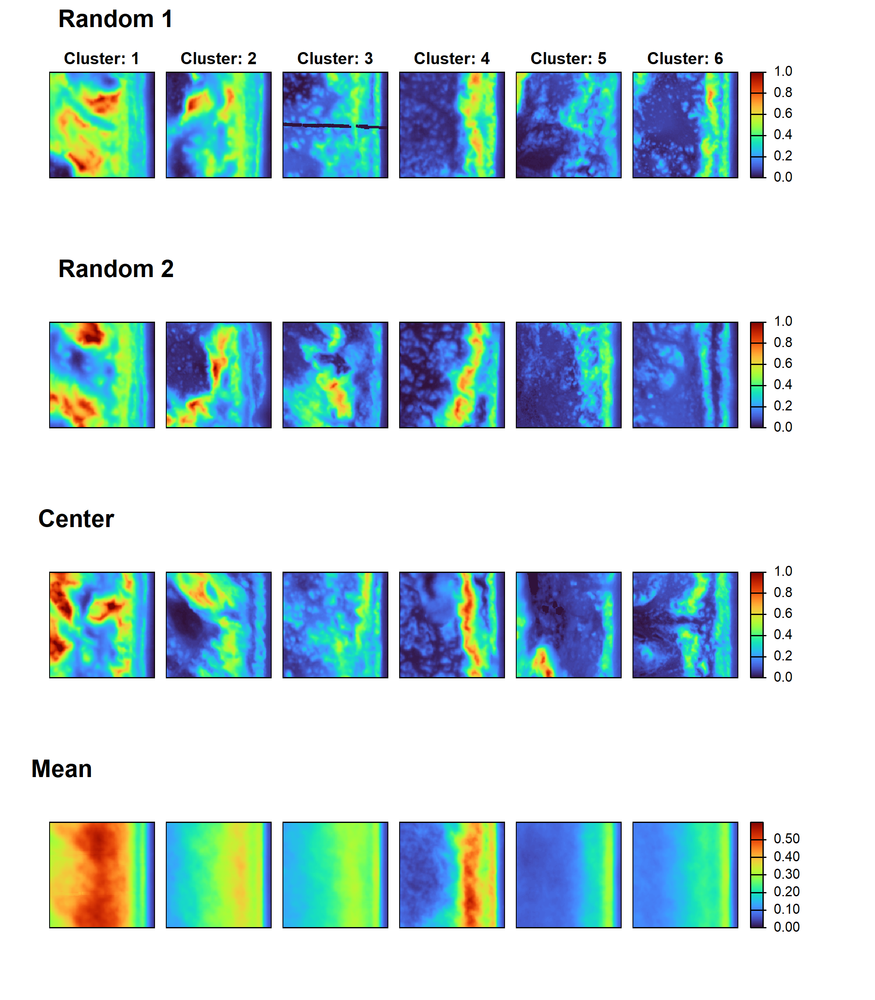
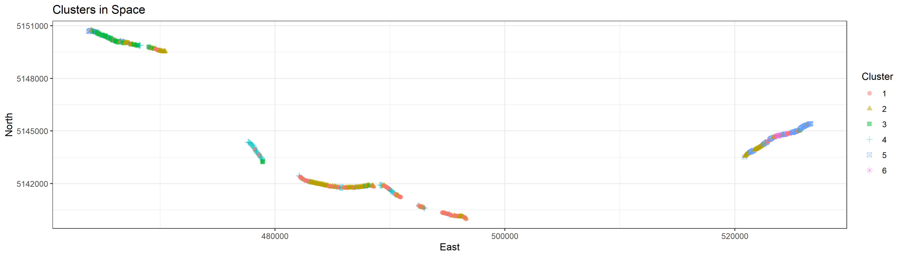
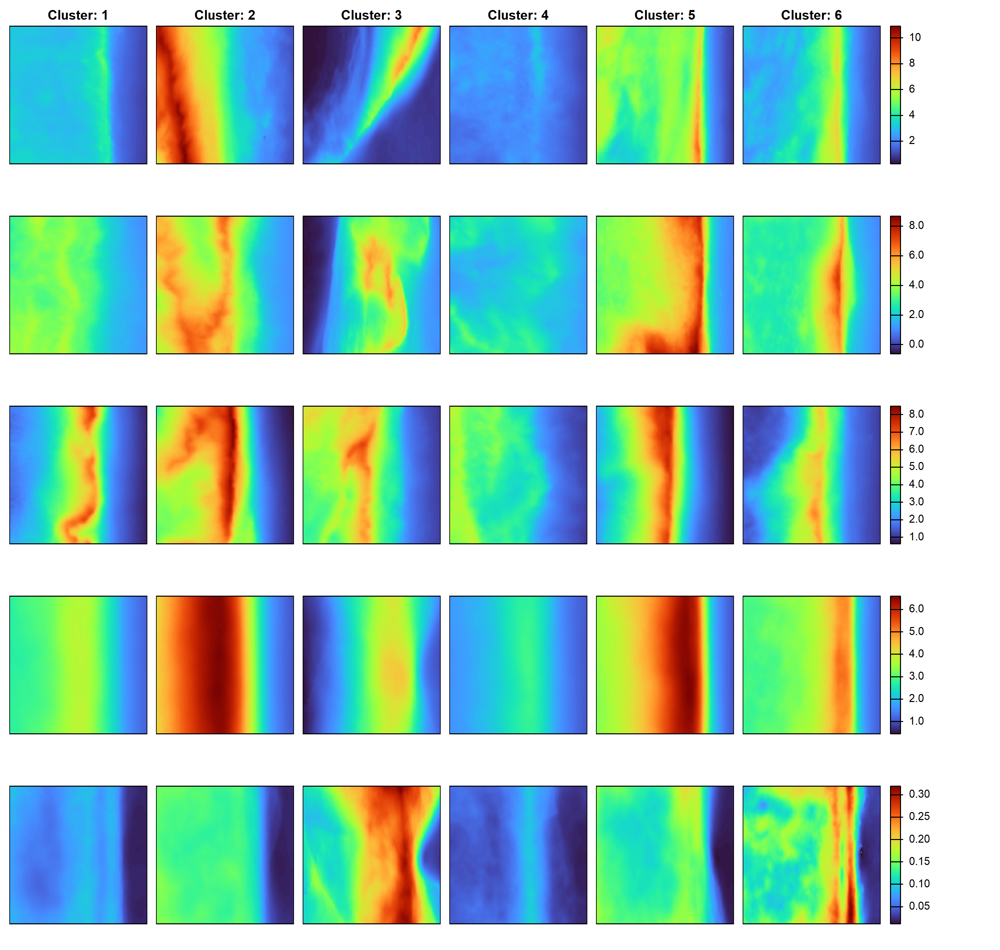

# Current research interests
Current research interests are aimed at large scale tool development for whole coast analysis, inter- and intra-site representative power of barrier island morphology, and translating alongshore resistance/resilience variability in barrier dune systems translates to evolution and potential management practices.

**Multi-Scale Topographic Anisotropy** (developed from Roy, 2016)

**Representative Power of Barrier Island Morphology**

**System-wide dune morphometric extraction** 
*developing*
Whole-coast dune toe/crest/hee; extraction through alongshore transects incorporating tidal gauge data for MHHW application.
Expanding segmentation models to generalize to entire coastal systems in a systematic and repeatable fashion for pre- and post-storm analysis.

**Alongshore Variability**
*developing*
Developing resistance-resilience matrix to understand morphological state of barrier dune systems 
XBeach model for assessing morphological scars (i.e., washovers, blowouts, etc.) influence response to storm events

**Topographic Embeddings**
*developing*
Expanding on the concept of embedding spaces for comparison and analysis of complex, multi-modal, barrier datasets to identify critical scales and synthesize marine/aeolian process influences.

